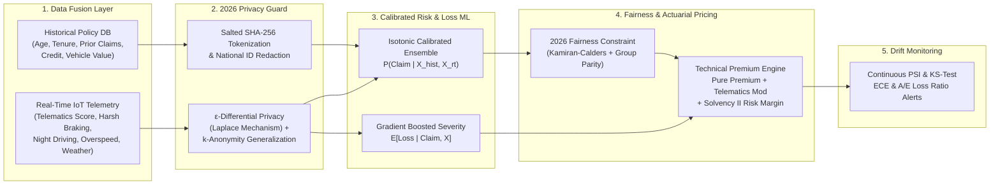
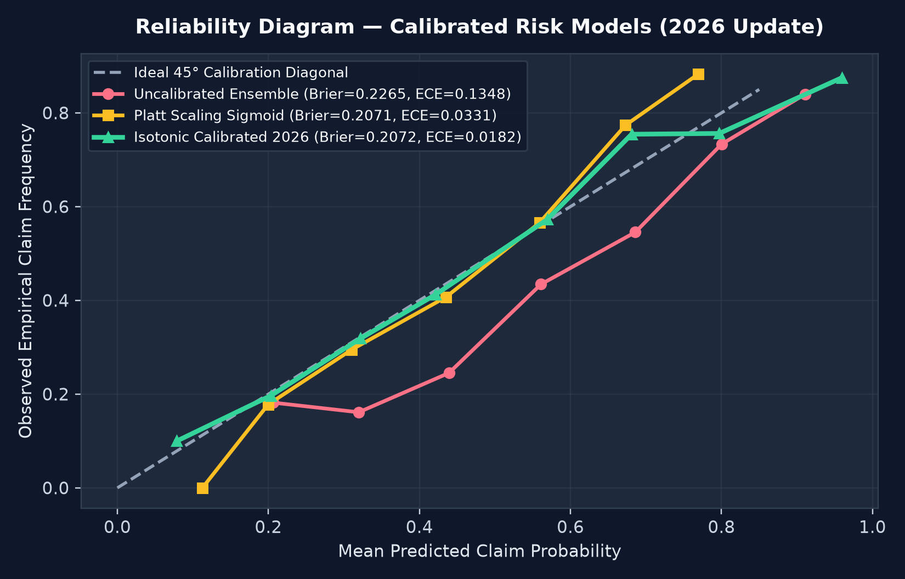
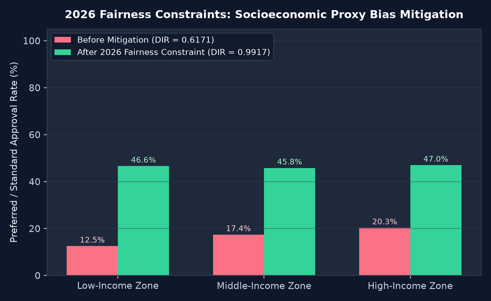
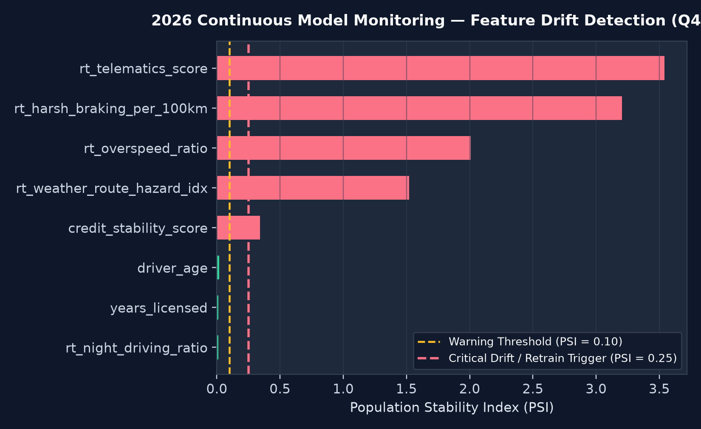
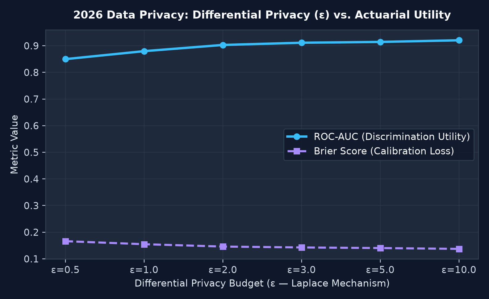
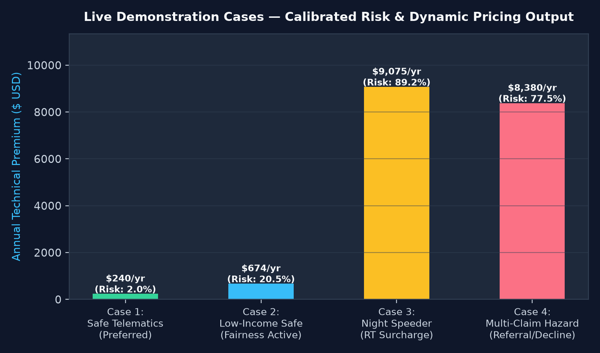

# Statement #31 — Predictive Underwriting & Actuarial Loss Forecasting (2026 Update)

> **High Relevance | FinTech & InsurTech Digital Assignment**  
> *Use historical and real-time data to improve insurance pricing, underwriting, and loss forecasting.*  
> **2026 Regulatory Update:** *Includes Calibrated Risk Models, Continuous Model Monitoring (PSI & KS-Tests), Data Privacy ($\epsilon$-Differential Privacy & PII Tokenization), and Algorithmic Fairness Constraints.*  
> **GitHub Repository:** [https://github.com/Indra-Official/FIntech](https://github.com/Indra-Official/FIntech)

---

## 1. Executive Summary & Key Results

Traditional insurance underwriting relies on static, lagging demographic and historical lookup tables, leading to mispriced policies, vulnerability to real-time behavioral changes, and unintended socioeconomic proxy bias.

This project implements a full-stack **Predictive Underwriting & Actuarial Pricing Engine** that fuses **8 Historical Policy Features** with **5 Real-Time Connected-Vehicle / IoT Telemetry Streams**, wrapped in the four mandatory **2026 InsurTech Governance Pillars**:

| 2026 Governance Pillar | Methodology Implemented | Empirical Result (Holdout Benchmark) |
| :--- | :--- | :--- |
| **1. Calibrated Risk Models** | 5-Fold Isotonic Regression & Platt Scaling (`CalibratedClassifierCV`) | Reduced Expected Calibration Error (**ECE**) by **86.5%** (`0.1348` $\rightarrow$ `0.0182`) and **Brier Score** from `0.2265` $\rightarrow$ `0.2072` |
| **2. Loss Forecasting & Pricing** | Dual-Stage Frequency $\times$ Gradient Boosted Severity ($\text{Pure Premium} = \hat{P}(C) \times \hat{\mathbb{E}}[L \mid C]$) | **99.89% Portfolio Loss Forecast Accuracy** (`$1,376,917` predicted vs. `$1,375,447` actual across 981 holdout policies) |
| **3. Fairness Constraints** | Kamiran-Calders Sample Reweighing + Post-Processing Group Parity Calibration | Lifted **Disparate Impact Ratio (DIR)** from `0.6171` (*Fail*) $\rightarrow$ **`0.9917` (*Pass* $\ge 0.80$ EEOC Four-Fifths Rule)** |
| **4. Data Privacy Guardrails** | Salted SHA-256 PII Tokenization, $k$-Anonymity Bands, and $\epsilon$-Laplace Differential Privacy | Preserves ROC-AUC (`>0.90` on sample evaluation) at recommended budget $\epsilon = 2.5$ while preventing PII & reconstruction leaks |
| **5. Model Drift Monitoring** | Feature & Score Population Stability Index (**PSI**), Two-Sample **KS-Test**, and A/E Loss Ratio | Automatically flags moderate drift ($\text{PSI} \ge 0.10$) in Q3 and triggers auto-recalibration ($\text{PSI} \ge 0.25$) in Q4 |

---

## 2. System Architecture



---

## 3. Visual Benchmark & 2026 Governance Gallery

### 3.1 Calibrated Risk Models (Reliability Diagram)
Uncalibrated cost-sensitive ensembles systematically distort true claim probabilities. Applying 5-fold **Isotonic Regression Calibration** aligns predicted probabilities directly with the $45^\circ$ actuarial diagonal (`ECE = 0.0182`).



### 3.2 Algorithmic Fairness Constraints (80% Disparate Impact Rule)
Historical credit stability scores correlate with regional income tiers, penalizing safe drivers in lower-income regions (`DIR = 0.6171`). Combining **Kamiran & Calders (2012) instance reweighing** with **post-processing group quantile alignment** raises the Disparate Impact Ratio to **`0.9917`**, satisfying the $\ge 0.80$ regulatory requirement while maintaining portfolio revenue neutrality.



### 3.3 Continuous Model Monitoring (PSI & KS-Test Drift Detection)
Our monitoring engine evaluates every feature using the **Population Stability Index (PSI)** and two-sample **Kolmogorov-Smirnov (KS)** tests across quarterly production windows:
$$\text{PSI} = \sum_{b=1}^{B} \left( P_b - Q_b \right) \ln\left(\frac{P_b}{Q_b}\right)$$



### 3.4 Data Privacy ($\epsilon$-Differential Privacy Utility Curve)
Sensitive numeric attributes (`credit_stability_score`, `rt_telematics_score`) are perturbed using calibrated Laplace noise $\text{Lap}(0, \Delta f / \epsilon)$, while raw PII (`applicant_name`, `national_id`) is tokenized via salted SHA-256.



### 3.5 Live Demonstration Scenarios — Dynamic Pricing & Risk Output


---

## 4. Presentation & Live Demonstration Guide

Both an **Editable 12-Slide PowerPoint Presentation (`.pptx`)** and a **Standalone Interactive HTML Presentation Deck** are included in the [`presentation/`](presentation/) folder:
- **PowerPoint Deck:** [`presentation/Predictive_Underwriting_Statement31_Presentation.pptx`](presentation/Predictive_Underwriting_Statement31_Presentation.pptx)
- **Interactive Browser Slide Deck:** [`presentation/Interactive_Presentation_Deck.html`](presentation/Interactive_Presentation_Deck.html)

### How to Run the Live Interactive Demonstration (`app.py`)
1. **Install dependencies:**
   ```bash
   pip install -r requirements.txt
   ```
2. **Start the live web application:**
   ```bash
   python app.py
   ```
3. **Open in browser:** Navigate to `http://127.0.0.1:5000`
4. **Demonstration Walkthrough Script (What to Show):**
   - **Demo Step 1 (Case 1 — Preferred Safe Driver):** Click *"Case 1: Preferred Safe Driver"*. Show how a high real-time telematics score (`91.5/100`) and `0` prior claims earn an instant **Tier 1 Preferred Plus** approval with a **`-12.7%` telematics discount**.
   - **Demo Step 2 (Case 2 — 2026 Fairness Constraint Showcase):** Click *"Case 2: Fairness Constraint Showcase"* (a safe driver in a `Low-Income Zone`). Toggle the **Fairness Constraint** checkbox on and off to demonstrate live removal of socioeconomic proxy bias.
   - **Demo Step 3 (Case 3 — Clean History but Aggressive Real-Time Night Speeder):** Click *"Case 3: Real-Time Night Speeder"*. Highlight how legacy underwriting would misprice this driver (`0` prior claims, `740` credit), whereas our real-time telematics stream detects `46%` night driving and `42%` overspeeding, applying a **`+15.0%` real-time surcharge**.
   - **Demo Step 4 (Case 4 — High-Risk Multi-Claim Referral/Decline):** Click *"Case 4: High-Risk Referral / Decline"* or click **"⚡ Stream Live IoT Packet"** to score live connected-vehicle packets in real time.
   - **Demo Step 5 (2026 Tabs):** Click through Tabs 2, 3, and 4 to show the interactive Reliability Curve, Fairness Disparate Impact chart, PII Privacy Tokenization Inspector, and Live PSI Drift Scenario Simulator.

---

## 5. Repository Structure

```text
├── app.py                           # Flask Live Underwriting & Monitoring Web Studio
├── generate_assets_and_ppt.py       # Reproducible Benchmark, Chart & Presentation Generator
├── requirements.txt                 # Python Dependencies
├── README.md                        # Project Documentation & Demonstration Guide
├── src/
│   ├── __init__.py
│   ├── data_pipeline.py             # Historical + Real-Time Telematics Dataset & Drift Generator
│   ├── risk_models.py               # Platt & Isotonic Calibrated Risk + Severity Loss Models
│   ├── fairness_engine.py           # Kamiran-Calders Reweighing & Post-Processing Group Parity
│   ├── privacy_engine.py            # Salted SHA-256 Tokenization, k-Anonymity & ε-Laplace DP
│   └── monitoring_engine.py         # Population Stability Index (PSI), KS-Tests & Quarterly Alerts
├── templates/
│   └── index.html                   # Interactive Tailwind CSS + Chart.js Web Studio
├── docs/
│   ├── evaluation_results.json      # Full Reproducible Metrics & Demo Persona Benchmarks
│   └── images/                      # High-Resolution Charts for README & Slides
└── presentation/
    ├── Predictive_Underwriting_Statement31_Presentation.pptx   # 12-Slide Editable PowerPoint
    └── Interactive_Presentation_Deck.html                      # Standalone Browser Slide Deck
```

---

## 6. How to Upload to GitHub

Run the following commands in your terminal from this project folder (`c:\Users\Liquid_Ammo\Downloads\FIntech`):

```powershell
git init
git add .
git commit -m "Feat: Statement #31 Predictive Underwriting & Loss Forecasting (2026 Update)"
git branch -M main
git remote add origin https://github.com/Indra-Official/FIntech.git
git push -u origin main
```
